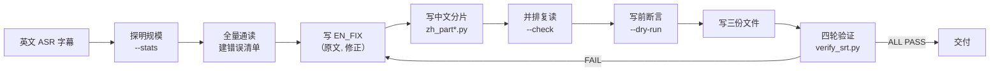

# SRT 字幕校对与翻译工作流

> 给 AI Agent 用的一套字幕处理技能：输入一份英文 ASR 字幕，输出**英文修正版 + 中文版 + 国内自媒体合规版**三份可直接播放的 SRT，并自动跑完四轮硬验证。


---

## 它解决什么问题

自动语音识别（ASR）产出的字幕有三类硬伤，肉眼很难一次改干净：

| 症状 | 例子 |
|---|---|
| **专名全错** | `Fontainebleau` → `fountain blue`、`Qwen` → `Quinn`、`Loews` → `Lowes`、`Forza Horizon 6` → `Sports Horizon 6` |
| **数字错得毫无破绽** | `140-watt` → `40-Watt`、`Llama 3.1 8B` → `Llama 3.18B`、`2,509` → `250099` |
| **句子被切碎、跨条错位** | 一句话拆成两三条，错误骑在条界上；译文整体偏移一位，整段串行 |

更隐蔽的是**工程性事故**：写文件时少一个「条目间空行」，播放器能正常加载，但按空行分块的工具会把整份 628 条的字幕当成 1 条，嵌进视频后**完全没有字幕**。

这套流程把上述问题固化成三个脚本 + 28 条铁律，让「校对、翻译、验证」变成可重复执行、可自证的步骤，而不是靠记忆和运气。

---

## 三份产出

与原视频同目录、同基底名，播放器可直接加载：

| 文件 | 内容 | 生成方式 |
|---|---|---|
| `<视频名>.srt` | 英文修正版 | **覆盖原文件**（原文自动备份） |
| `<视频名>_zh.srt` | 中文正常版 | 逐条对应，时间码不动 |
| `<视频名>_zh_douyin.srt` | 国内自媒体合规版 | 只改需要改的少数条目，条数与时间码完全不变 |

---

## 核心能力

### 1. 专名四层模糊检索

同一个专名常被 ASR 拼成好几种错法（`Omarchy` 就有 `Olmarky` / `O-Markey` / `O-Marky` / `Omarky` 四种）。靠肉眼翻，必漏。

```bash
python scripts/dump_srt.py "视频名.srt" --find "Fontainebleau"
```

| 层级 | 匹配方式 | 能抓到 |
|---|---|---|
| L1 | 原样子串 | 精确命中 |
| L2 | 归一化（忽略大小写 / 空格 / 连字符） | `Fountain Blue`、`fountainblue` |
| L3 | 辅音骨架（去元音后比对） | `fountain blue` ↔ `Fontainebleau`、`Lowes` ↔ `Loews` |
| L4 | 相似度兜底（difflib，默认 ≥ 0.78） | 拼得最离谱的那几种 |

此外会把每两条相邻条目**拼接后再搜一遍**——专名被切在条界上时（`…including New` / `and Square,`），单看每一条都对不上。

### 2. 防错位的硬断言

英文修正字典推荐写成 `(原文整条, 修正后整条)` 元组：

```python
EN_FIX = {
    2: ("the three Michelin star Uliassi. Beautiful.",
        "the three-Michelin-star Uliassi. Beautiful."),
}
```

条目号只要偏移一位，`old` 对不上原文就**立刻报错**——这比任何事后复查都可靠。配合专名断言与「未修正条目保持原文」断言，整段平移无处藏身。

### 3. 写盘前的全量断言

`process_template.py` 在动任何文件之前会顺序跑完：

原文断言 → 漏词审计（修正后骤减 3 词以上即拦截）→ 专名断言 → untouched 断言 → resid 预检（防止残留词表命中自己写对的正文）→ 中文完整性 → 标点检查 → 全量漂移检测

任何一项不过就退出，**不会产生半成品文件**。

### 4. 写盘后的四轮硬验证

`verify_srt.py` 直接可跑，退出码 `0` = 全部通过：

```bash
python scripts/verify_srt.py "视频名.srt" --resid "Sally,mission star"
```

| 轮次 | 检查内容 |
|---|---|
| 第一轮 | 英文条数、key 连续、时间码、BOM 恰好 1 个、全 CRLF、**条目间空行 = N−1**、无解析残留尾块 |
| 第二轮 | 中文 100% 覆盖、无空条目、无全角冒号 `：`、无破折号 `——`、无重复标点 |
| 第三轮 | 纯拉丁行（整行无中文）= 0 |
| 第四轮 | 三份时间码逐条一致、**全量**内容漂移检测（按条目号对齐，不是抽样） |

外加：ASR 残留错误形态清零、合规版禁用词残留 = 0、合规改写条目数核对。

### 5. 合规版同步产出

翻译时一次性写出 `_zh.srt` 和 `_zh_douyin.srt`，不事后补救。合规版把境外平台名、订阅/频道话术、导流链接、未申报推广统一换成中性表述，**不删句子、不改时间码**，避免删句导致中文过短而触发漂移告警。

```bash
python scripts/process_template.py --keys    # 逐条打印 EN + ZH，确认禁用词真实落点
```

---

## 安装

把整个 `srt-proofread-translate` 文件夹放进 Agent 的技能目录：

| 系统 | 路径 |
|---|---|
| Windows | `C:\Users\<用户名>\.workbuddy\skills\srt-proofread-translate\` |
| macOS / Linux | `~/.workbuddy/skills/srt-proofread-translate/` |

**唯一依赖**：Python 3.10+，只用标准库，不需要 `pip install` 任何东西。

找不到 `python` 命令时用绝对路径，例如：

```powershell
& "C:\Program Files\Python311\python.exe" scripts\verify_srt.py "视频名.srt"
```

装完先自检三条：

```bash
python scripts/verify_srt.py --help
python scripts/dump_srt.py --help
python scripts/process_template.py --help
```

---

## 工作流



### 常用命令

| 场景 | 命令 |
|---|---|
| 看规模、编码、尾块 | `python scripts/dump_srt.py "视频.srt" --stats` |
| 通读原文 | `python scripts/dump_srt.py "视频.srt"` |
| 分段读 | `python scripts/dump_srt.py "视频.srt" 1 120` |
| 并排复读中英 | `python scripts/dump_srt.py "视频.srt" --zh --out check.txt` |
| 搜专名所有错拼 | `python scripts/dump_srt.py "视频.srt" --find "Qwen"` |
| 降低相似度阈值再搜 | `python scripts/dump_srt.py "视频.srt" --find "Hakkasan" --thresh 0.7` |
| 写文件前试跑 | `python scripts/process_template.py --dry-run` |
| 生成并排复读文件 | `python scripts/process_template.py --check` |
| 写三份文件并自动验证 | `python scripts/process_template.py` |
| 四轮验证（全量） | `python scripts/verify_srt.py "视频.srt" --resid "Sally,mission star"` |
| 只验英文修正 | `python scripts/verify_srt.py --en a.srt` |

> `process_template.py` 是**模板**：复制改名后填写 `CONFIG`、`EN_FIX` 和中文分片，再运行。首次运行会把原文备份成 `<视频名>_en_original.srt`，之后永远从备份读，因此可以反复重跑，结果字节一致。

---

## 目录结构

```
srt-proofread-translate/
├── SKILL.md                     # 完整流程 + 28 条铁律 + 交付清单
├── scripts/
│   ├── dump_srt.py              # 通读 / 并排复读 / 四层模糊检索 / 概况统计
│   ├── verify_srt.py            # 四轮验证（可直接运行，退出码 0/1）
│   └── process_template.py      # 处理脚本模板：断言 → 写盘 → 字节自检 → 调 verify
└── references/
    ├── asr_patterns.md          # ASR 误识模式库，40+ 个真实项目、70+ 类模式
    └── douyin_compliance.md     # 国内自媒体合规替换表
```

`references/asr_patterns.md` 是这套流程最厚的资产：每个真实项目沉淀一段，记录该片的高频误识、考据结论、断言写法差异和踩过的坑。新项目先在这里查有没有同类模式，能省掉大半猜测。

---

## 设计原则

- **条数是骨架**：任何情况下都不删条目，幻听整句也照原样翻译并单独标注。删一条，后面全错位。
- **存疑不臆造**：查不到的专名、听不懂的乱句，保留原文，中文用中性表述带过；这些词绝不放进残留词表，否则自造假告警。
- **整条替换，不跨条合并**：一条修正只改自己条目内的词，绝不把邻条内容拼进来。
- **验证器报错先辨真假**：中文数字 vs 阿拉伯数字、专名括注导致中文字数偏少，都是常见误报；语义完全无关才是真错位。
- **中间产物隔离**：备份、脚本、分片译文、复读文件全部放进 `_tmp_<项目>/`，交付后整体删除，视频目录只留三份成品。

---

## 适用与不适用

**适合**：访谈、vlog、科技评测、酒店/餐厅探店、旅行长片等 100–1300 条规模的英文（或日文）ASR 字幕，尤其是专名密集、数字参数密集的片子。

**不太适合**：已经有专业人工字幕的影片（用不上修正）、需要强制对齐到词级的硬字幕烧制（本工具不处理视频）。

---

## License

[MIT](LICENSE)
